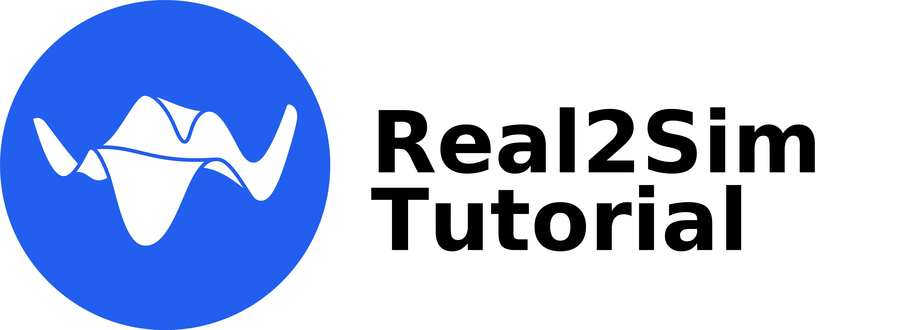
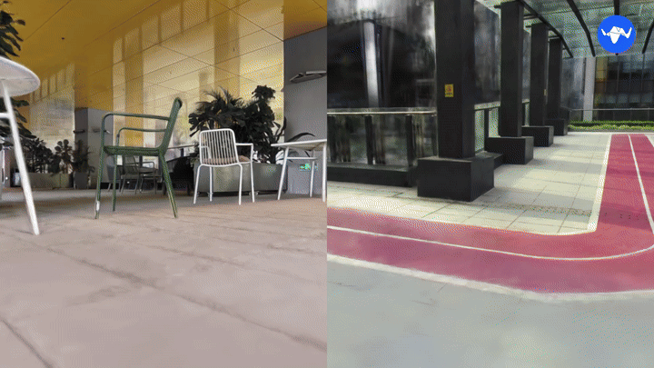

# MT Real2Sim Tutorial

<p align="center">
  
</p>

<p align="center">
  
</p>

[简体中文](README_cn.md)

Unified simulation ↔ real-robot algorithm framework built on Isaac Sim 5.1 and ROS1 Noetic. Simulation and physical deployment share the same ROS1 interfaces and algorithm code — zero modifications needed.

## About Manifold Tech

[Manifold Tech Ltd.](https://manifoldtech.cn) builds tools and infrastructure for spatial intelligence. We focus on 3D reconstruction, scene understanding, and embodied AI — bridging the gap between real-world capture and interactive simulation.

Manifold Tech's hardware products — including the **Q9000**, **Pocket 2 / 2 Pro**, and **Odin 1** — can capture high-quality 3D models of real-world environments. These scanned scenes can be imported directly into Isaac Sim as simulation environments, enabling seamless Real-to-Sim transfer for robot navigation and autonomous exploration.

## Architecture

```
┌──────────────── Host (Linux + NVIDIA Driver) ─────────────────┐
│                                                                │
│  Docker: Isaac Sim 5.1                                         │
│  ┌────────────────────────────────────────┐                    │
│  │ RL Policy (Go2)                         │                    │
│  │ SensorSuite (RTX LiDAR + Camera + IMU)  │                    │
│  │ TcpBridgeServer ───────────────────────────┐                │
│  │   send: pose + pointcloud + image          │                │
│  │   recv: cmd_vel                            │                │
│  └────────────────────────────────────────┘   │                │
│                                                │                │
│              TCP localhost:9090                 │                │
│                                                │                │
│  Docker: ROS Noetic                            │                │
│  ┌─────────────────────────────────────────┐   │                │
│  │  sim_bridge    → /state_estimation      │◄──┘                │
│  │                → /registered_scan       │                    │
│  │                → /camera/image          │                    │
│  │                → TF: map → sensor       │                    │
│  │                ← /cmd_vel               │                    │
│  │                                         │                    │
│  │  nav_algo (C++)  terrain_analysis       │                    │
│  │                  local_planner          │                    │
│  │                  path_follower          │                    │
│  │                                         │                    │
│  │  nav_demo (Py)   teleop / auto_nav     │                    │
│  │  RViz                                   │                    │
│  └─────────────────────────────────────────┘                    │
└────────────────────────────────────────────────────────────────┘

Real robot: replace sim_bridge with odin_driver; nav_algo + nav_demo unchanged
```

## Project Structure

```
mt-real2sim-tutorial/
├── r2s2r/                             # Isaac Sim side Python package
│   ├── core/                          #   Simulation core modules
│   │   ├── sensor_suite.py            #     Camera + LiDAR + IMU manager
│   │   ├── scene_builder.py           #     USDZ environment import + collision + lighting
│   │   ├── robot_factory.py           #     Robot factory (Go2)
│   │   ├── go2_policy.py              #     Go2 RL policy controller
│   │   └── perf_timer.py              #     Performance timer
│   ├── bridge/                        #   TCP bridge (no ROS dependency)
│   │   ├── protocol.py                #     Binary protocol (magic + msgpack)
│   │   └── tcp_server.py              #     Non-blocking TCP server
│   ├── configs/                       #   Simulation config + sensor calibration
│   │   ├── config.yaml                #     Unified simulation config
│   │   ├── go2.yaml                   #     Go2 standalone config
│   │   └── calibration/pinhole/       #     Camera + LiDAR + IMU intrinsics/extrinsics
│   └── run_sim.py                     #   Main entry point
│
├── ros1_ws/src/                       # ROS1 workspace (Docker catkin)
│   ├── sim_bridge/                    #   TCP↔ROS1 bridge (Python)
│   ├── nav_algo/                      #   Navigation algorithms (C++)
│   ├── nav_demo/                      #   Demo: teleop + visualization
│   └── odin_interfaces/               #   Real robot driver interface (placeholder)
│
├── docker-full/                       # Docker dual-container orchestration
│   ├── Dockerfile.isaac               #   Isaac Sim image
│   ├── docker-compose.yml             #   Isaac Sim + ROS1 compose
│   └── entrypoint_isaac.sh            #   Container entrypoint
│
├── lidar_configs/                     # Custom LiDAR config (see docs/lidar_guide.md)
│   ├── json/MT_MLXS.json             #   MT-MLXS profile (based on ZVISION ML-Xs)
│   └── usd/MT_MLXS.usd              #   Converted USD file
│
├── tools/                             # Utility scripts
│   ├── convert_lidar_json.py          #   LiDAR JSON → USD converter
│   ├── ros_teleop.sh                  #   One-click bridge + teleop
│   └── run_isaac_docker.sh            #   Run Isaac Sim inside container
│
├── start.sh                           # One-click start/stop script
│
└── docs/                              # Documentation
    ├── user_guide.md                  #   User guide (setup + operation)
    └── lidar_guide.md                 #   Custom LiDAR configuration guide
```

## ROS1 Interfaces

| Topic | Message Type | Description |
|-------|-------------|-------------|
| `/state_estimation` | `nav_msgs/Odometry` | Robot pose + velocity (frame: map) |
| `/registered_scan` | `sensor_msgs/PointCloud2` | World-frame LiDAR point cloud |
| TF: `map → sensor` | `tf/tfMessage` | Sensor coordinate transform |
| `/cmd_vel` | `geometry_msgs/Twist` | Velocity command (linear.x/y + angular.z) |

## Quick Start

Prerequisites: NVIDIA driver (>=560) + Docker + nvidia-container-toolkit + [NGC account](https://ngc.nvidia.com/)

```bash
# First time: NGC login
docker login nvcr.io --username '$oauthtoken' --password <YOUR_NGC_API_KEY>

# Clone
git clone https://git.manifoldtech.cn/Ethan/mt-real2sim-tutorial.git
cd mt-real2sim-tutorial

# One-click launch
./start.sh

# Stop
./start.sh --stop
```

For detailed instructions see [docs/user_guide.md](docs/user_guide.md).
