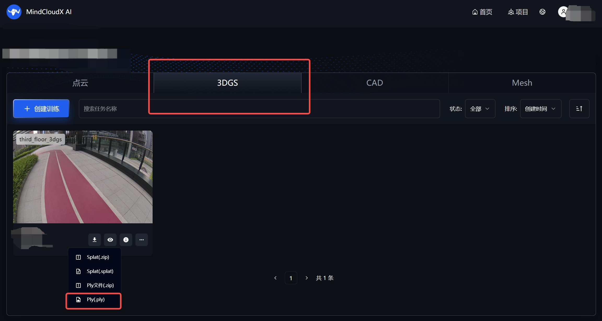
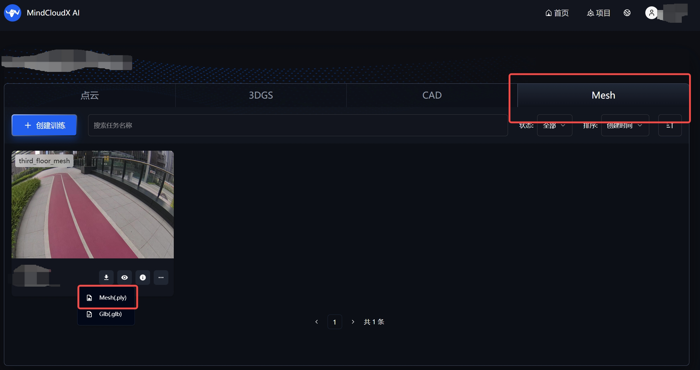
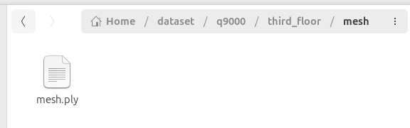
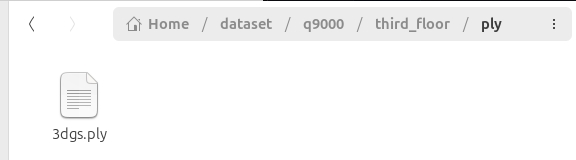
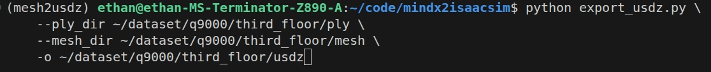
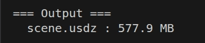
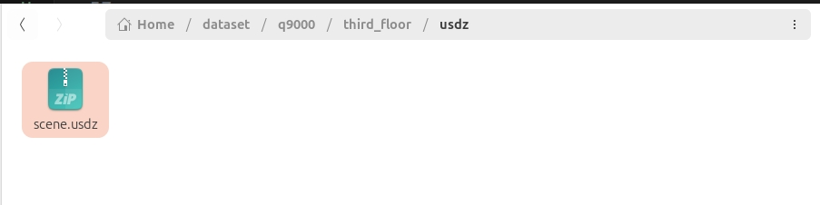
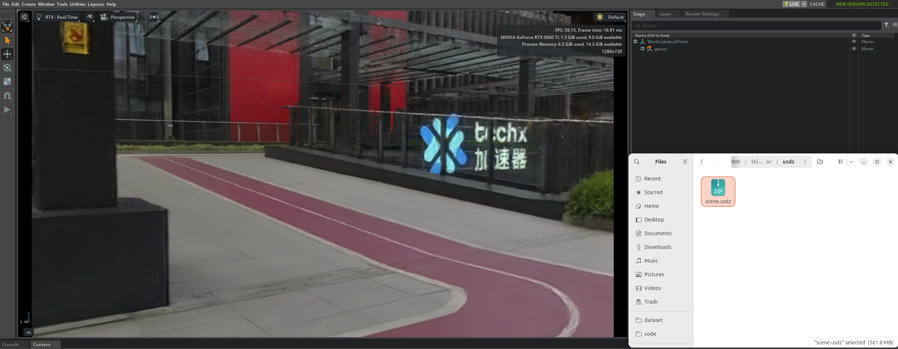

# MT Real2Sim Tutorial — Importing MindCloudX AI Scenes into Isaac Sim

Convert **3D Gaussian Splatting (3DGS)** and **Mesh** data exported from the [MindCloudX AI](https://mindcloudx.ai/) platform into **USDZ** scene files that NVIDIA Isaac Sim can load directly, enabling high-fidelity RGB rendering + PhysX collision detection.

---

## Directory Structure

```
mt-r2s/
├── tutorial.md            ← This document
├── src/                   ← Conversion script source code
│   ├── export_usdz.py    ← Unified entry point
│   ├── ply_to_usdz.py    ← 3DGS PLY → NuRec USDZ (with coordinate transform)
│   ├── add_mesh_to_usdz.py ← Mesh PLY → USD collision body injection
│   ├── requirements.txt   ← Python dependencies
│   └── README.md          ← Detailed parameter reference
└── img/                   ← Tutorial screenshots and demo video
```

---

## 1. Background

### 1.1 Isaac Sim Scene File Format

Isaac Sim is built on the NVIDIA Omniverse platform and uses **USD (Universal Scene Description)** as its scene format:

- **USDZ** is the packaged form of USD (essentially an uncompressed ZIP), bundling `.usda`/`.usd` and referenced assets into a single file
- Isaac Sim loads `.usdz` files via `File → Add Reference` or the Python API
- A USDZ can contain both a **3DGS visual layer** (NuRec Gaussian rendering) and a **collision mesh layer** (PhysX physics collision)

### 1.2 MindCloudX AI Platform Data

| Data Type | Coordinate System | Purpose |
|-----------|------------------|---------|
| 3DGS PLY | **Y-up** | High-fidelity visual rendering |
| Mesh PLY | **Z-up** (gravity-aligned) | Collision detection |

Since Isaac Sim uses a **Z-up** coordinate system, the 3DGS must be transformed from Y-up to Z-up before packaging. This tool handles the transformation automatically.

---

## 2. Environment Setup

### 2.1 System Requirements

- Ubuntu 20.04 / 22.04 / 24.04
- Python **3.10 ~ 3.12** (`open3d` does not yet provide prebuilt packages for 3.13+)

### 2.2 Install Dependencies

```bash
# Recommended: use conda for an isolated environment
conda create -n mindcloudx2usdz python=3.12 -y
conda activate mindcloudx2usdz

# Install dependencies
cd docs/mt-r2s/src
pip install -r requirements.txt
```

Dependency overview:

| Package | Purpose |
|---------|---------|
| `numpy` | Array computation |
| `plyfile` | PLY file parsing |
| `open3d` | Mesh decimation (Quadric Decimation) |
| `usd-core` | OpenUSD Python bindings (USDZ generation) |
| `msgpack` | NuRec model data serialization |
| `scipy` | SH coefficient coordinate rotation (Wigner-D) |

> **Tip**: If Isaac Sim is already installed, you can reuse its built-in Python environment (which includes `pxr`), eliminating the need to install `usd-core` separately.

---

## 3. Workflow

### 3.1 Download Data

Download the following from the MindCloudX AI platform:

**① 3DGS file (PLY format)**



**② Mesh file (PLY format)**



### 3.2 Organize File Directory

```
~/data/my_scene/
├── ply/
│   └── 3dgs.ply       ← 3DGS (Y-up, from cloud training)
└── mesh/
    └── mesh.ply        ← Mesh (Z-up)
```

### 3.3 Run Conversion

```bash
cd docs/mt-r2s/src

python export_usdz.py \
    --ply_dir ~/data/my_scene/ply \
    --mesh_dir ~/data/my_scene/mesh \
    -o ~/data/my_scene/usdz
```







The following output indicates success:



The output directory now contains `scene.usdz`:



### 3.4 Import into Isaac Sim

1. Open Isaac Sim
2. `File → Add Reference`, select the generated `scene.usdz`
3. The scene appears with visual rendering and collision bodies



4. In the Property panel, confirm `PhysicsCollisionAPI` is enabled
5. Place a robot, click ▶ PLAY to interact

**Demo video**: [demo](./img/v1.mp4)

---

## 4. Common Parameters

| Parameter | Default | Description |
|-----------|---------|-------------|
| `--ply_dir` | — | Directory containing 3DGS PLY |
| `--mesh_dir` | — | Directory containing Mesh PLY |
| `-o` | — | USDZ output directory |
| `--y_up` / `--no-y_up` | enabled | Auto-convert Y-up 3DGS to Z-up |
| `--simplify_faces` | 500000 | Mesh decimation target face count (0 = no decimation) |
| `--max_dist` | 200 | Remove Gaussians farther than this from origin |
| `--mesh_visible` | false | Whether mesh is visible (default: invisible, collision only) |

For the full parameter reference, see [`src/README.md`](./src/README.md).

---

## 5. Important Notes

### ⚠️ Excessive Mesh Face Count Causes Collision Pass-Through

PhysX silently fails on collision when mesh exceeds approximately **5 million faces**. The default `--simplify_faces 500000` decimates to 500K faces. Recommended range: **500K ~ 1M faces**.

### ⚠️ collision_approx Must Be `none`

For collision meshes imported via USDZ, only `none` (exact triangle collision) works correctly. The script default is already set correctly — no modification needed.

### ⚠️ Coordinate System Mismatch (Scene Flipped)

If the scene appears incorrectly oriented after import:
- 3DGS is already Z-up → add `--no-y_up`
- Mesh is not Z-up → re-export from the platform or manually transform

---

## 6. Integration with Real2Sim2Real Project

After conversion, place `scene.usdz` in the `~/dataset/isaac/` directory, then update the simulation config:

```yaml
# r2s2r/configs/config.yaml
scene:
  environment:
    usdz_path: "~/dataset/isaac/scene.usdz"
```

Launch the simulation:

```bash
./start.sh
```

For detailed deployment instructions, see the [User Guide](../user_guide.md).

---

## References

- [NVIDIA Isaac Sim Documentation](https://docs.omniverse.nvidia.com/isaacsim/latest/)
- [OpenUSD Official Documentation](https://openusd.org/release/index.html)
- [MindCloudX AI Platform](https://mindcloudx.ai/)
